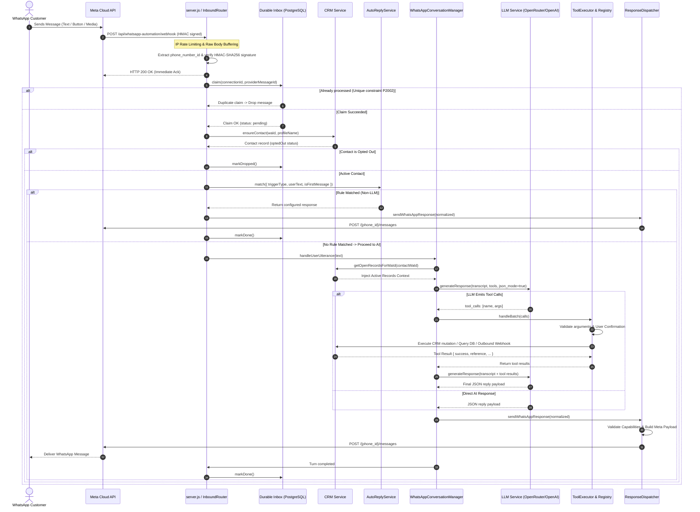
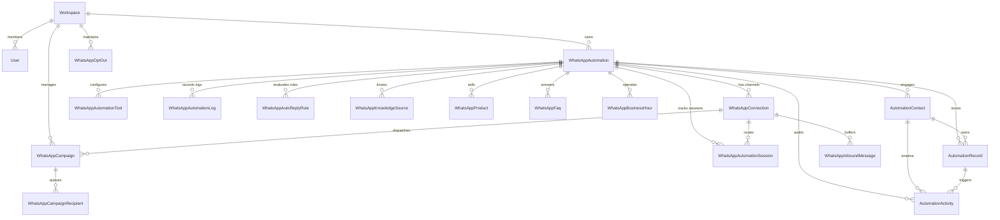

# Callify WhatsApp Automation SaaS — System Architecture

This document provides a comprehensive technical breakdown of the WhatsApp Automation SaaS architecture implemented in the Callify platform (`server/src/whatsappAutomation`, `server/src/campaigns`, and `frontend/src`).

---

## 1. System Overview

Callify is a multi-tenant B2B SaaS platform that empowers businesses to automate customer communications on WhatsApp. It bridges end-customers on WhatsApp with business operations, combining rule-based auto-replies, an autonomous LLM agent with real-time CRM tool execution, outbound broadcast campaigns, and human agent live handoff.

```
┌────────────────────────┐         WhatsApp (Meta Cloud API / Baileys)
│ WhatsApp End Customers │ ◄─────────────────────────────────────────────────► ┐
└────────────────────────┘                                                     │
                                                                               │ Webhooks &
                                                                               │ REST API
┌────────────────────────┐         Web App (React / Tailwind)                  ▼
│  Businesses / Admins   │ ◄────────────────────────────────────────► ┌─────────────────┐
│ (Agents, CRM, Settings)│                                            │  Callify Server │
└────────────────────────┘                                            │  (Express/Node) │
                                                                      └────────┬────────┘
                                                                               │
                                                      ┌────────────────────────┼────────────────────────┐
                                                      ▼                        ▼                        ▼
                                              ┌───────────────┐        ┌───────────────┐        ┌───────────────┐
                                              │  PostgreSQL   │        │ OpenRouter /  │        │  External Web-│
                                              │  (Prisma ORM) │        │  OpenAI LLM   │        │  hooks & APIs │
                                              └───────────────┘        └───────────────┘        └───────────────┘
```

### Who Uses the System

1. **Businesses & Workspace Admins**:
   - Configure business identity, industry, operating hours, and tone of voice.
   - Supply knowledge bases, structured product catalogues, and FAQs.
   - Connect phone numbers via Meta WhatsApp Cloud API credentials or Baileys QR code.
   - Define custom tools, webhooks, and deterministic auto-reply rules.
   - Monitor live customer logs, manage the CRM pipeline (contacts, stages, custom fields, records), and conduct human takeovers.
   - Launch and monitor broadcast marketing campaigns.

2. **WhatsApp End Customers**:
   - Interact naturally via WhatsApp text, interactive reply buttons, sectioned list menus, location sharing, media, and template quick replies.
   - Inquire about products, pricing, working hours, and FAQs.
   - Book appointments, request site visits/demos, check request statuses using reference IDs, and lodge customer complaints.
   - Opt out/in using standard keywords (`STOP` / `START`).
   - Request escalation to human representatives when automated assistance is insufficient.

---

## 2. End-to-End Message Flow

The inbound message lifecycle processes untrusted webhooks through signature validation, persistence, rate limiting, rule matching, AI reasoning, tool execution, and outbound delivery.

### Step-by-Step Execution Sequence

1. **Webhook Reception & Rate Limiting**:
   - Meta sends an HTTP POST request to `/api/whatsapp-automation/webhook` (or connection-scoped `/webhook/:connectionId`).
   - `server.js` captures raw request bytes (`req.rawBody`) before JSON parsing to preserve signature integrity.
   - In-memory `RateLimiter` enforces IP-level protection (default: 600 req/min). Payloads exceeding 1 MB are destroyed.

2. **Tenant Scoping & Webhook Signature Verification**:
   - `inboundRouter.js` inspects `entry[].changes[].value` to extract `phone_number_id` and WABA `id` (`webhookScope.js`).
   - Resolves target `WhatsAppConnection` rows from the database.
   - Decrypts connection secrets via `secretBox.js` (AES-256-GCM).
   - Validates `X-Hub-Signature-256` against `connection.appSecret` using HMAC-SHA256 timing-safe comparison (`CloudApiProvider.js`).
   - Unsigned requests or invalid signatures are rejected (HTTP 401).

3. **Immediate HTTP 200 Acknowledgment**:
   - The server immediately responds with `HTTP 200 OK` to Meta *before* executing the LLM pipeline, preventing Meta webhook retry storms.

4. **Status Updates & Inbound Deduplication**:
   - Delivery statuses (`sent`, `delivered`, `read`, `failed`) are extracted and passed to `campaigns.onStatusUpdates()` to update recipient state.
   - Inbound messages are normalized across types (text, button replies, list selections, flow replies, media, locations).
   - Compliance hook: `STOP`, `UNSUBSCRIBE`, `CANCEL` update the workspace opt-out registry (`WhatsAppOptOut`).
   - Deduplication: In-memory `TtlDedup` (10-minute window) checks `providerMessageId`. If unseen, the message is inserted into `WhatsAppInboundMessage` (`inbox.claim`) with status `pending`.

5. **Contact Rate Limiting & Concurrency Serialization**:
   - Contact-level rate limiter checks message frequency (default: 30 msgs/min per contact).
   - `KeyedMutex` locks execution per `${connectionId}:${contactWaId}`. Messages for the same contact are processed serially, while different contacts run concurrently (up to `WHATSAPP_CONTACT_CONCURRENCY = 10`).

6. **Session & CRM Contact Initialization**:
   - In-memory `sessionStore` is queried; if expired or missing, session state is loaded from the `WhatsAppAutomationSession` table (24-hour TTL).
   - `crmService.ensureContact()` upserts the sender into `AutomationContact` (capturing WhatsApp ID and profile name).
   - If contact has opted out (`optedOut: true`), automated processing halts.

7. **Deterministic Rule-Based Auto-Reply Evaluation**:
   - `AutoReplyService` evaluates enabled rules for the automation ordered by `priority ASC`.
   - Supports triggers: `first_message`, `keyword`, `button_press`, `list_row`, `flow_reply`, `always`.
   - Matching modes: `exact`, `contains`, `prefix`, `starts_with`, `regex`.
   - If matched:
     - Attachment probing (`probeMediaUrl`) checks external media reachability and size.
     - Outgoing message is formatted and sent via `channelAdapter.sendResponse()`.
     - User turn and auto-reply are recorded in the transcript.
     - The message is marked `done` in `WhatsAppInboundMessage`, bypassing the LLM.

8. **AI Reply with Dynamic Context & Tool Calling**:
   - If no auto-reply rule matched, `conversationManager.handleUserUtterance()` takes over.
   - Open CRM records for this customer are retrieved (`getOpenRecordsForWaId`) and injected as fresh system context (`CUSTOMER OPEN RECORDS CONTEXT`).
   - `promptBuilder.js` constructs the system prompt combining core behavioral guardrails, saved business data, hours, catalog, and Cloud API response schemas.
   - LLM service streams the response with `tools` schema and `response_format: { type: "json_object" }`.
   - If the model issues tool calls:
     - `WhatsAppToolExecutor.handleBatch()` validates arguments against schemas.
     - Executes mutation guardrails (confirmation checks, stale detail re-ask, duplicate record checks).
     - Executes handlers (CRM updates, business queries, custom tools, or outbound webhooks).
     - Tool results are appended to transcript; LLM re-prompts to produce customer-facing JSON.

9. **Response Normalization & Delivery**:
   - `normalizeWhatsAppResponse()` extracts JSON, sanitizes text into WhatsApp markdown (`*bold*`, bullets, link formats), and enforces schema constraints (e.g., max 3 buttons, max 10 list rows).
   - Checks account capabilities (`isCapabilityEnabled`).
   - `metaPayloadBuilder.js` formats official Meta Graph API v20.0 JSON payloads.
   - `CloudApiProvider.sendMessagePayload()` dispatches payload to `https://graph.facebook.com/v20.0/{phoneNumberId}/messages` with exponential backoff for 429/5xx codes.
   - Logs event to `WhatsAppAutomationLog` and increments `messagesSent`.
   - Inbox record marked `done`.

### Mermaid Sequence Diagram: Inbound Message Flow



---

## 3. Tool Calling Architecture & Registry

Tool calling in Callify is managed by `WhatsAppToolRegistry` and executed via `WhatsAppToolExecutor`. Tools are strictly sandboxed: the model only sees tools enabled for that specific automation, and the executor rejects any tool not registered.

```
                  ┌──────────────────────────────┐
                  │    WhatsAppToolRegistry      │
                  └──────────────┬───────────────┘
                                 │
         ┌───────────────────────┼───────────────────────┐
         ▼                       ▼                       ▼
┌─────────────────┐     ┌─────────────────┐     ┌─────────────────┐
│ Built-in CRM &  │     │ Custom Business │     │ Outbound HTTP   │
│ General Tools   │     │ Record Tools    │     │ Webhook Tools   │
└─────────────────┘     └─────────────────┘     └─────────────────┘
```

### 1. Built-in CRM Tools

| Tool Name | Parameters | Description | Per-Business Behavior & Validation |
| :--- | :--- | :--- | :--- |
| `crm_get_contact` | None | Retrieves customer profile, tags, stage, open records, and last 8 activities. | Scoped to current `contactWaId` and `automationId`. Resolves contact automatically. |
| `crm_update_contact` | `name`, `email`, `company`, `city`, `customFields` (object) | Saves verified customer details into the CRM profile. | Strips empty strings. Sanitizes lengths. Appends custom fields without overwriting existing ones. Logs timeline activity. |
| `crm_set_stage` | `stage` (enum: `new`, `contacted`, `qualified`, `proposal`, `won`, `lost`), `reason` | Progresses lead through sales pipeline. | Validates against `crm.STAGES` enum. Logs `stage_change` event to customer timeline. |
| `crm_update_tags` | `add` (string array), `remove` (string array) | Adds or removes classification tags on customer. | Normalizes to lowercase slug; enforces 30 tags limit. |
| `crm_add_note` | `note` (string, required) | Logs internal staff note to customer timeline. | Max 2,000 chars. Tagged as `createdBy: 'ai'`. Never shown to customer. |
| `crm_create_record` | `title` (string, req), `type` (string, req), `fields` (object), `dueDate` (ISO string), `rebook` (bool) | Creates booking, lead, or complaint ticket. | **Enforces explicit confirmation check** in transcript. Verifies duplicate open records. Generates reference code (`REQ-XXXX-YYYY`). |
| `crm_list_records` | None | Lists all active open records for current customer. | Fetches up to 20 open records for active `contactId`. |
| `crm_change_record_status` | `reference` (string, req), `status` (string, req) | Updates record status (`done`, `cancelled`, `open`). | Verifies reference belongs to contact. **Enforces customer confirmation check** in transcript. |

### 2. Built-in General Tools

| Tool Name | Parameters | Description | Validation & Logic |
| :--- | :--- | :--- | :--- |
| `get_current_datetime` | None | Gets current date, time, and day of week in configured business timezone. | Uses `automation.timezone` via `Intl.DateTimeFormat`. Resolves relative terms like "tomorrow". |
| `get_business_hours` | None | Checks opening hours and reports if business is open right now. | Queries `WhatsAppBusinessHour` table for current weekday and matches local time against open/close intervals. |
| `search_products` | `query` (string, optional) | Searches business catalogue products/services. | Case-insensitive search on `name`, `description`, `category`. Returns top 10 enabled products. |
| `search_faq` | `query` (string, req) | Searches FAQ knowledge base. | Keyword tokenization and matching over `question` and `keywords`. Returns top 3 scored matches. |
| `check_request_status` | `reference` (string, req) | Checks status of a request/booking by its reference code. | Queries `AutomationRecord` by unique reference. Formats user-friendly status description. |
| `check_my_requests` | None | Lists open requests for current customer without requiring reference. | Queries `AutomationRecord` where `status == 'open'` for contact. Flags whether records are older (>24h). |
| `request_human_handoff` | `reason` (string, req) | Escalates chat to human agent. | Logs handoff activity, creates `callback` record, switches session to `human_handoff`, returns holding message. |

### 3. Custom Business Tools (`customTool.js`)

Businesses create domain-specific data collection forms (e.g., `book_site_survey`, `register_complaint`, `request_quote`):
- **Schema Generation**: Dynamically creates OpenAI function schema with configured properties, marking mandatory fields in `required`.
- **System Injected Parameters**:
  - `user_confirmed` (boolean): Enforces confirmation requirement.
  - `rebook` (boolean): Permits recreation if older request exists.
- **Validation Pipeline**:
  1. *Missing Field Check*: Halts with `MISSING_REQUIRED_FIELDS` if any required field is empty.
  2. *Freshness Check*: Evaluates whether parameters (addresses, issue descriptions) were provided in the *current request scope*, preventing stale parameter reuse from past bookings (`UNPROVIDED_CUSTOMER_DETAILS`).
  3. *Explicit Confirmation Verification*: Inspects conversation transcript to verify that the assistant summarized details and the customer explicitly replied with confirmation words (`yes`, `confirm`, `proceed`, etc.) before permitting execution (`NEED_USER_CONFIRMATION`).
  4. *Active Record Guard*: Checks if an open record of the same category exists. If recent, blocks creation with `EXISTING_OPEN_RECORD`; if old (>24h), prompts rebook confirmation (`EXISTING_OLD_RECORD`).

### 4. Outbound Webhook Tools (`WebhookToolExecutor.js`)

Admins can configure external REST API tools (e.g., Cal.com, internal order databases):
- **Schema**: Maps JSON schema from `tool.parameters`.
- **Security & SSRF Guard (`urlGuard.js`)**:
  - `assertHttpUrl()` validates protocol (`http:` or `https:`).
  - `resolveSafeHost()` performs DNS lookup and blocks private, loopback, link-local, and multicast IP ranges (e.g., `127.0.0.1`, `10.0.0.0/8`, `169.254.0.0/16`).
  - DNS Pinning: Uses `pinnedLookup()` to prevent DNS rebinding attacks.
- **Credential Interpolation**: `interpolateEnvVars()` safely substitutes `{{TOOL_*}}` or `{{WEBHOOK_TOOL_*}}` tokens from `process.env`.
- **Data Transformation**: Supports dot-notation `paramMapping` and `staticBody` injection.

---

## 4. Database Architecture & Multi-Tenancy

Callify uses PostgreSQL managed via Prisma ORM (`server/prisma/schema.prisma`).

### Multi-Tenancy Enforcement Model

Multi-tenancy is structured around **`Workspace`** (`workspaceId`):
1. **API Level**: Express middleware (`routes.js`) extracts `workspaceId` from authenticated user session (`req.user.workspaceId`). The route parameter guard `router.param('automationId', ...)` ensures the automation belongs to the user's workspace; otherwise, it returns HTTP 404.
2. **Inbound Webhook Level**: Webhooks do not carry session cookies. Isolation is enforced through:
   - Dedicated webhook URLs with `connectionId` or global lookup by `phoneNumberId` / `businessId`.
   - HMAC-SHA256 signature verification against the specific connection's `appSecret`.
   - Routing conflict validation (`findRoutingConflict`) prevents duplicate registrations of the same `phoneNumberId` or `instanceId` across workspaces.
3. **CRM Isolation**: Contacts, activities, and records are scoped to `automationId`, which cascades from `Workspace`.

*(Note: The codebase uses `workspaceId` and `automationId` for tenant scoping; `customer_id` does not exist in the code).*

### Core Tables & Key Columns

#### Multi-Tenant & Automation Engine
- **`Workspace`**: Tenant boundary (`id`, `name`, `createdAt`, `updatedAt`).
- **`User`**: Application operators (`id`, `workspaceId`, `email`, `passwordHash`, `role`).
- **`WhatsAppAutomation`**: Master automation configuration (`id`, `workspaceId`, `name`, `status`, `systemPrompt`, `businessName`, `timezone`, `fallbackMode`, `handoffKeywords`, `behaviorConfig`, `promptConfig`).
- **`WhatsAppConnection`**: Channel credentials (`id`, `automationId`, `provider`, `phoneNumber`, `phoneNumberId`, `businessId`, `instanceId`, `apiToken` [encrypted], `verifyToken`, `appSecret` [encrypted], `enabled`).
- **`WhatsAppInboundMessage`**: Durable deduplication inbox (`id`, `connectionId`, `providerMessageId`, `contactWaId`, `status`, `attempts`, `payload`).
- **`WhatsAppAutomationTool`**: Enabled tools (`id`, `automationId`, `name`, `schema`, `config`, `enabled`).
- **`WhatsAppAutomationSession`**: Conversation session (`id`, `automationId`, `connectionId`, `contactWaId`, `status`, `transcript`, `messagesSent`, `messagesReceived`, `toolCalls`, `llmCalls`, `lastActivityAt`).
- **`WhatsAppAutomationLog`**: Audit logs (`id`, `automationId`, `connectionId`, `sessionId`, `level`, `category`, `event`, `message`, `metadata`).
- **`WhatsAppAutoReplyRule`**: Deterministic rules (`id`, `automationId`, `name`, `triggerType`, `triggerKey`, `triggerValue`, `matchMode`, `response`, `responseConfig`, `responseType`, `priority`, `enabled`).
- **`WhatsAppKnowledgeSource`**: Raw documents (`id`, `automationId`, `type`, `title`, `content`, `enabled`).
- **`WhatsAppProduct`**: Catalog (`id`, `automationId`, `name`, `description`, `price`, `category`, `imageUrl`, `enabled`).
- **`WhatsAppFaq`**: Q&A pairs (`id`, `automationId`, `question`, `answer`, `keywords`, `priority`, `enabled`).
- **`WhatsAppBusinessHour`**: Operating hours (`id`, `automationId`, `dayOfWeek`, `enabled`, `openTime`, `closeTime`).

#### Automation CRM Subsystem
- **`AutomationContact`**: WhatsApp customers (`id`, `automationId`, `waId`, `name`, `email`, `company`, `city`, `stage`, `tags`, `customFields`, `optedOut`, `messageCount`, `lastMessageAt`).
- **`AutomationActivity`**: Customer timeline events (`id`, `automationId`, `contactId`, `recordId`, `type`, `content`, `metadata`, `createdBy`).
- **`AutomationRecord`**: Leads, bookings, and complaints (`id`, `automationId`, `contactId`, `type`, `title`, `reference`, `status`, `fields`, `dueDate`, `createdBy`).

#### Broadcast Campaigns Subsystem
- **`WhatsAppCampaign`**: Broadcast metadata (`id`, `workspaceId`, `connectionId`, `name`, `channel`, `status`, `templateName`, `templateSnapshot`, `messageText`, `concurrency`, `ratePerMinute`, `maxAttempts`, `dailyLimit`).
- **`WhatsAppCampaignRecipient`**: Leased recipient queue (`id`, `campaignId`, `phone`, `variables`, `status`, `attempts`, `lockedBy`, `lockedUntil`, `providerMessageId`, `sentAt`, `deliveredAt`, `readAt`, `failedAt`).
- **`WhatsAppCampaignStatusEvent`**: Out-of-order webhook buffer (`id`, `connectionId`, `providerMessageId`, `status`, `occurredAt`).
- **`WhatsAppOptOut`**: Workspace-level unsubscribe registry (`id`, `workspaceId`, `phone`, `source`).

### Mermaid Entity-Relationship Diagram



---

## 5. Onboarding & Connection Setup

### Connection Architecture: Reality vs. Embedded Signup

> [!IMPORTANT]
> **Codebase Clarification on Embedded Signup**:
> Meta's "Embedded Signup" flow (Facebook Login SDK popup running `FB.login` with `launchWhatsAppSignup` and OAuth token exchange) is **not implemented** in this codebase.
> 
> Instead, businesses connect numbers via two mechanisms:
> 1. **Meta Cloud API (Manual Credential Linkage)**
> 2. **Baileys QR Code (Emulated WhatsApp Web Client)**

#### 1. Meta Cloud API Setup
- **Required Inputs**: `phoneNumberId`, `businessId` (WABA ID), `apiToken` (Permanent System User Access Token), `verifyToken`, and optional `appSecret`.
- **Pre-flight Validation (`/api/whatsapp-automation/verify-cloud`)**:
  - Hits Meta Graph API v20.0 `GET /{phoneNumberId}?fields=display_phone_number,verified_name,quality_rating`.
  - Verifies that the Phone Number ID belongs to the configured Business Account ID.
- **Webhook Configuration**:
  - Callify exposes `/api/whatsapp-automation/webhook` (or connection-scoped `/webhook/:connectionId`).
  - GET endpoint responds to Meta's `hub.challenge` verification when `hub.verify_token` matches.
  - Secret fields (`apiToken`, `appSecret`) are encrypted at rest using AES-256-GCM (`secretBox.js`).

#### 2. Baileys QR Code Setup
- Connects using `@whiskeysockets/baileys` over a dedicated WebSocket connection (`ws://<host>/baileys`).
- Emulates a companion web device: generates a QR code streamed over WebSocket for the operator to scan with WhatsApp mobile app.
- Persists credentials to disk under `./baileys_auth/<instanceId>`.

### The 8-Step Setup Wizard (`WhatsAppAutomationSetupPage.jsx`)

1. **Business Profile**: Business name, industry category, description, primary language, supported multi-languages, timezone, and phone/email/address details.
2. **Channel Setup**: Choice between Meta Cloud API and Baileys QR code, credential inputs, verification button, and webhook URL copying.
3. **Knowledge Base**: Freeform business text knowledge, structured product catalogue (name, category, price, image URL), and FAQ lists with trigger keywords.
4. **Agent Behavior & Tools**: Selection of tone (`friendly`, `professional`, etc.), response length, fallback behavior, system prompt builder, built-in tool toggles, and the Custom Tools visual editor.
5. **Business Hours**: Day-by-day availability toggles, open/close time pickers, and after-hours away response configuration.
6. **Auto-Replies**: Creation of deterministic no-LLM trigger rules with rich interactive response designers (buttons, lists, CTA URLs, media attachments).
7. **Interactive Simulator**: Live chat testing sandbox simulating WhatsApp mobile UI. Tests auto-replies, LLM responses, and mock tool calls.
8. **Review & Activate**: Summary checklist validating required fields, with option to save as `draft` or launch as `active`.

---

## 6. Client Dashboard & UI Architecture

The frontend is a single-page React application built with Vite and Tailwind CSS.

### Page Routes, APIs & Displayed Data

| Route Path | Component | APIs Consumed | Data Displayed & Functionality |
| :--- | :--- | :--- | :--- |
| `/whatsapp` | `WhatsAppAutomationsPage.jsx` | `GET /api/whatsapp-automation`<br>`POST /api/whatsapp-automation` | Card/table list of automations, status badges (active/paused), connected phone numbers, and creation modal. |
| `/whatsapp/setup`<br>`/whatsapp/setup/:id` | `WhatsAppAutomationSetupPage.jsx` | `GET /api/whatsapp-automation/:id`<br>`PUT /api/whatsapp-automation/:id`<br>`POST /api/whatsapp-automation/verify-cloud`<br>`GET /api/baileys/instances` | 8-step onboarding wizard: business details, credentials, products, FAQs, tools, hours, auto-replies, and live mobile preview. |
| `/whatsapp/automation/:id` | `WhatsAppAutomationDetailsPage.jsx` | Multiple tab-specific endpoints (see below) | Master management console organized into 6 tabs: |
| ↳ *Tab: Overview* | DetailView in `WhatsAppAutomationDetailsPage` | `GET /api/whatsapp-automation/:id`<br>`GET /:id/stats/messages` | High-level metrics: total messages sent/received, LLM tokens, tool call volume, business prompt preview, system status. |
| ↳ *Tab: CRM & Leads* | `CrmTab.jsx` | `GET /:id/crm/summary`<br>`GET /:id/crm/contacts`<br>`PATCH /:id/crm/contacts/:id`<br>`GET /:id/crm/records`<br>`POST /:id/crm/contacts/:id/message` | Contact list with stage filter, full activity timeline, open records/bookings management, stage updater, and manual message sender. |
| ↳ *Tab: Live Logs* | `LogsTab.jsx` | `GET /:id/logs`<br>`GET /:id/logs/stats`<br>`GET /:id/logs/recent` | Real-time audit log stream: filterable by category (`message`, `tool`, `auto_reply`, `llm`, `error`), log level, and session ID. |
| ↳ *Tab: Auto-replies* | Rules editor in `automationKit.jsx` | `GET /:id/auto-replies`<br>`POST /:id/auto-replies`<br>`PUT /:id/auto-replies/:ruleId`<br>`DELETE /:id/auto-replies/:ruleId` | Rule builder with triggers (`keyword`, `button_press`, etc.), matching mode selector, rich interactive builder, and media attachment uploader. |
| ↳ *Tab: Channels* | Channels section | `POST /:id/connections`<br>`PUT /:id/connections/:connId`<br>`DELETE /:id/connections/:connId`<br>`GET /:id/connections/:connId/status` | Active WhatsApp connections, connection health status, QR code scanner (Baileys), and Meta Cloud credential editor. |
| ↳ *Tab: Settings* | Settings editor | `PUT /:id`<br>`DELETE /:id` | Prompt configuration, custom tools builder (`CustomToolsEditor.jsx`), knowledge documents, FAQs, hours, and danger zone (delete). |
| `/whatsapp/crm` | `WhatsAppCrmPage.jsx` | `GET /api/whatsapp-automation/crm/*` *(Note: Buggy endpoint)* | Standalone CRM dashboard intended for multi-automation lead tracking. |
| `/whatsapp/campaigns` | `CampaignsPage.jsx` | `GET /api/campaigns` | Broadcast campaign overview: status badges, delivery rates, total recipients, sent/failed metrics. |
| `/whatsapp/campaigns/new` | `CampaignCreatePage.jsx` | `POST /api/campaigns`<br>`POST /api/campaigns/preview-recipients`<br>`GET /api/campaigns/templates` | Campaign wizard: channel selector, CSV/XLSX recipient file uploader, template parameter mapping, rate limit controls. |
| `/whatsapp/campaigns/:id` | `CampaignDetailsPage.jsx` | `GET /api/campaigns/:id`<br>`POST /api/campaigns/:id/launch`<br>`POST /api/campaigns/:id/pause` | Real-time campaign progress, recipient delivery statuses (`queued`, `sent`, `delivered`, `read`), and controls (launch/pause/cancel). |

---

## 7. Background Jobs, Rate Limits & Billing

### Background Jobs & Workers

1. **Campaign Broadcast Worker (`server/src/campaigns/worker.js`)**:
   - Initialized at server launch (`server.js` line 134: `campaigns.startWorker()`).
   - Ticks every 2,000ms (`tickMs: 2000`).
   - Leases recipients from `WhatsAppCampaignRecipient` table using atomic `SKIP LOCKED` queries (`lockedBy`, `lockedUntil`), ensuring worker safety across restarts.
   - Enforces per-campaign in-memory token bucket rate limiting (`ratePerMinute` and `concurrency`).
   - Handles auto-pausing on authentication/payment failures and implements exponential backoff on transient errors.

2. **Durable Inbox Recovery (`server/src/whatsappAutomation/factory.js`)**:
   - Started at boot (`startInboxRecovery`).
   - Ticks every 60 seconds.
   - Queries `WhatsAppInboundMessage` for rows remaining in `pending` status where `updatedAt` is older than 5 minutes (`STALE_MS`).
   - Replays orphaned messages with at-least-once delivery semantics (up to `MAX_ATTEMPTS = 3`, after which rows are marked `failed`).
   - Periodically purges completed inbox entries older than 7 days (`inbox.purge()`).

3. **In-Memory Session Sweep (`server/src/whatsappAutomation/sessionStore.js`)**:
   - Runs every 10 minutes (`sweepMs: 10 * 60 * 1000`).
   - Evicts cached in-memory sessions inactive for over 24 hours (`ttlMs`).
   - Enforces LRU-style eviction if memory exceeds 5,000 active sessions.

4. **In-Memory Concurrency Cleanup (`server/src/whatsappAutomation/concurrency.js`)**:
   - `TtlDedup` sweeps expired message hashes every 10 minutes.
   - `RateLimiter` sweeps expired IP and contact windows when keys exceed 50,000 entries.

### System Usage Limits & Plan Caps

| Dimension | Configured Limit | Implementation Mechanism | Location in Code |
| :--- | :--- | :--- | :--- |
| **Webhook Ingestion** | 600 req / minute per IP | In-memory `RateLimiter` | `server.js:18-20` |
| **Webhook Payload Size** | 1,048,576 bytes (1 MB) | Raw byte length stream counter | `server.js:21, 32` |
| **Contact Message Rate** | 30 msgs / minute per contact | DB count on `WhatsAppInboundMessage` (fallback: in-memory limiter) | `runtime.js:18-21, 386-395` |
| **Contact Concurrency** | 10 parallel contacts | `mapLimit` over grouped incoming messages | `runtime.js:22, 375` |
| **LLM Context Window** | 40 messages | Transcript slicing (`transcript.slice(-40)`) | `conversationManager.js:24, 249` |
| **Tool Calling Rounds** | 6 iterations per turn | `maxRoundsPerTurn` counter in tool executor | `WhatsAppToolExecutor.js:13, 86` |
| **Meta Buttons Limit** | 3 buttons max | Slice enforcement in normalizer & payload builder | `responseNormalizer.js:301`, `metaPayloadBuilder.js:75` |
| **Meta List Limit** | 10 sections / 10 rows max | Array slicing in normalizer & payload builder | `responseNormalizer.js:381`, `metaPayloadBuilder.js:109` |
| **Media Probe Limits** | Images: 5MB; Video: 16MB; Docs: 100MB | Axios streaming range request check | `autoReplyService.js:33-37` |

### Billing Architecture

> [!WARNING]
> **No Active Billing / Plan Caps in WhatsApp Automation**:
> The WhatsApp automation modules (`src/whatsappAutomation` and `src/campaigns`) contain **no active billing enforcement, usage quotas, plan gating, or subscription tier middleware**.
> 
> While `.env` contains leftover Razorpay keys (`RAZORPAY_KEY_ID`) and credit constants from a legacy mock interview codebase, these are completely unreferenced in the WhatsApp automation server code. All automations and campaigns currently run unmetered without plan caps.

---

## 8. Deployment, Environment & Third-Party Services

### Deployment Architecture

- **Backend Runtime**: Node.js v18+ running Express, HTTP server, and WebSocket server (`ws`).
- **Database**: PostgreSQL hosted on Supabase (configured via pooling connection string).
- **Process Model**: Single process managing HTTP, WebSocket listeners, background campaign worker, and inbox recovery timers. Graceful termination handled on `SIGINT`/`SIGTERM`.
- **Frontend Hosting**: Static build (`npm run build`) hosted via static web server or reverse proxy (Nginx).

### Environment Variables Reference

| Variable Name | Required? | Default Value | Description |
| :--- | :--- | :--- | :--- |
| `DATABASE_URL` | **Yes** | — | PostgreSQL connection URI (e.g. Supabase pooler). |
| `WHATSAPP_SECRETS_KEY` | **Yes (Prod)** | — | 32-byte key (64 hex or base64) for AES-256-GCM encryption of connection secrets. |
| `OPENROUTER_API_KEY` | Conditional | — | API key for OpenRouter LLM gateway. |
| `OPENAI_API_KEY` | Conditional | — | Fallback direct OpenAI API key if OpenRouter is absent. |
| `SERVER_URL` | **Yes** | `localhost` | Public domain or ngrok host for webhooks and media links. |
| `PORT` / `VOICE_PORT` | No | `8083` | HTTP and WebSocket port. |
| `NODE_ENV` | No | `development` | Deployment mode (`production` enforces secret keys and webhook signatures). |
| `CORS_ORIGINS` | No | `*` (reflects all) | Comma-delimited list of allowed browser origins. |
| `WHATSAPP_PHONE_NUMBER_ID` | No | — | Global fallback Meta Phone Number ID. |
| `WHATSAPP_BUSINESS_ACCOUNT_ID`| No | — | Global fallback Meta WhatsApp Business Account (WABA) ID. |
| `WHATSAPP_ACCESS_TOKEN` | No | — | Global fallback Meta System User Access Token. |
| `WHATSAPP_VERIFY_TOKEN` | No | — | Global fallback Meta Webhook verification token. |
| `WHATSAPP_APP_SECRET` | No | — | Global fallback Meta App Secret for HMAC verification. |
| `WHATSAPP_API_VERSION` | No | `v20.0` | Meta Graph API version string. |
| `BAILEYS_AUTH_FOLDER` | No | `./baileys_auth` | Local filesystem directory for Baileys auth credentials. |
| `WEBHOOK_RATE_LIMIT` | No | `600` | Ingestion rate limit (requests per window). |
| `WEBHOOK_RATE_WINDOW_MS` | No | `60000` | Ingestion rate limit window in ms (1 minute). |
| `WHATSAPP_CONTACT_RATE_LIMIT` | No | `30` | Inbound messages per minute allowed per contact. |
| `WHATSAPP_CONTACT_CONCURRENCY`| No | `10` | Concurrency limit for parallel contact processing. |
| `WHATSAPP_INBOX_MAX_ATTEMPTS` | No | `3` | Max retries before marking an inbox message failed. |
| `WHATSAPP_INBOX_STALE_MS` | No | `300000` | Cutoff before a pending inbox message is replayed (5 min). |
| `CRM_OLD_RECORD_HOURS` | No | `24` | Age threshold in hours to treat a record as "older". |
| `WEBHOOK_ENV_ALLOWLIST` | No | — | Allow-listed environment variables accessible to custom tool webhooks. |

### Third-Party Services Integrated

1. **Meta WhatsApp Cloud API (`graph.facebook.com/v20.0`)**: Official messaging provider for WhatsApp Business accounts. Handles templates, interactive buttons, list messages, media uploads, and delivery statuses.
2. **OpenRouter / OpenAI (`openrouter.ai` / `api.openai.com`)**: LLM providers powering customer dialogue and function/tool calling.
3. **Baileys (`@whiskeysockets/baileys`)**: Free WebSocket-based WhatsApp Web protocol companion emulator for development and demo testing.
4. **Supabase PostgreSQL**: Cloud-hosted relational database.
5. **Telnyx / Deepgram / ElevenLabs / Sarvam / Fish Audio**: Voice, STT, and TTS integrations present in the repository for the companion voice agent subsystem.

---

## 9. Known Bugs, Risks & Missing Pieces

The following findings represent confirmed bugs, security vulnerabilities, architectural limitations, and missing features identified directly in the active codebase:

### 1. Critical Severity

#### Bug 1: Unmounted Root CRM Endpoint & Missing Record Endpoints in `WhatsAppCrmPage.jsx`
- **Location**: `frontend/src/pages/WhatsAppCrmPage.jsx:7, 18, 43, 70, 76, 84-90`
- **Issue**: `WhatsAppCrmPage.jsx` sets `const API = `${SERVER_URL}/api/whatsapp-automation/crm``. However, in `server/src/whatsappAutomation/routes.js:132`, the CRM router is only mounted as a sub-router scoped by automation ID:
  ```javascript
  router.use('/:automationId/crm', createCrmRouter((req) => req.params.automationId));
  ```
  There is no route mounted at `/api/whatsapp-automation/crm`. As a result, visiting `/whatsapp/crm` triggers immediate HTTP 404 errors for `/summary` and `/contacts`.
- **Secondary Issue**: `WhatsAppCrmPage.jsx` calls `axios.patch(`${API}/tasks/${t.id}`)` and `axios.post(`${API}/contacts/${contact.id}/tasks`)`, and renders `contact.tasks` and `contact.deals`. The backend CRM was refactored to generic `AutomationRecord` (`/records`, `/records/:recordId`), and has no `/tasks` or `/deals` endpoints.

#### Bug 2: Webhook Signature Verification Bypass in Non-Production Environments
- **Location**: `server/src/integrations/whatsapp/CloudApiProvider.js:53-57`
- **Issue**:
  ```javascript
  verifyInbound(req) {
    if (!this.appSecret) {
      // Fail closed in production; unsigned webhooks are only tolerated in development
      return process.env.NODE_ENV !== 'production';
    }
  ```
  `appSecret` is an optional field in `WhatsAppConnection` (`appSecret String?` in `schema.prisma:67`). If an admin does not configure `appSecret`, and the application is run in staging, test, or development (`NODE_ENV !== 'production'`), the server accepts any incoming webhook with zero signature validation. An attacker can forge incoming webhook payloads to impersonate any WhatsApp sender.

---

### 2. High Severity

#### Bug 3: Cross-Tenant Data Leakage via Workspace ID Fallback
- **Location**: `server/src/whatsappAutomation/routes.js:105-112`
- **Issue**:
  ```javascript
  async function resolveWorkspaceId(req) {
    if (req.user.workspaceId) return req.user.workspaceId;
    const workspace = await dbService.prisma.workspace.findFirst({
      where: { name: 'Default Workspace' },
      select: { id: true },
    }) || await dbService.prisma.workspace.findFirst({ select: { id: true } });
    return workspace?.id || null;
  }
  ```
  If an authenticated user record has a `null` `workspaceId`, the resolver falls back to the *first workspace found in the entire database*. This user is then granted administrative access to view, edit, or delete automations and contacts belonging to another tenant's workspace.

#### Bug 4: In-Memory Mutex & Deduplication Failure in Multi-Instance Deployments
- **Location**: `server/src/whatsappAutomation/runtime.js:16-17, 197` & `server/src/whatsappAutomation/concurrency.js:8-29`
- **Issue**: `sessionMutex = new KeyedMutex()` and `processedMessages = new TtlDedup()` operate exclusively in local Node.js process memory. If the backend is deployed with multiple instances (e.g. AWS ECS, Kubernetes, or Node cluster mode) behind a load balancer without sticky sessions, incoming webhooks for the same contact reaching different server instances bypass the mutex. This causes simultaneous LLM transcript corruption, race conditions on CRM writes, and duplicate outbound messages.

#### Bug 5: Ephemeral Baileys Authentication Storage
- **Location**: `server/src/whatsappAutomation/factory.js:50-52` & `server/src/integrations/whatsapp/baileysProvider.js:18, 45`
- **Issue**: Baileys multi-file auth credentials are saved to local filesystem paths (`./baileys_auth/<instanceId>`). In containerized deployments (Docker/Kubernetes) without persistent volume mounts, restarting or rescheduling containers destroys the credentials, dropping the WhatsApp connection and requiring the user to rescan the QR code.

---

### 3. Medium Severity

#### Bug 6: Webhook Socket Destruction Causes Meta Webhook Retry Floods
- **Location**: `server/server.js:32-35`
- **Issue**:
  ```javascript
  if (size > MAX_WEBHOOK_BODY_BYTES) {
    req.destroy();
    return;
  }
  ```
  When an incoming webhook exceeds 1 MB, `req.destroy()` abruptly closes the TCP socket without returning an HTTP response status. Meta's webhook delivery system treats socket closures as network drops and retries delivery repeatedly with exponential backoff, exacerbating server load instead of dropping the message with HTTP 413 or 200.

#### Bug 7: False Positive Confirmations in Mutation Tools via Simple Substring Matching
- **Location**: `server/src/whatsappAutomation/tools/builtinTools.js:122-124` & `server/src/whatsappAutomation/tools/customTool.js:189-191`
- **Issue**: Confirmation validation checks:
  ```javascript
  const confirmWords = ['yes', 'yep', 'yeah', 'sure', 'ok', 'okay', 'correct', 'confirm', 'proceed', 'go ahead', 'do it', 'please', 'fine', 'looks good', 'right', 'agree'];
  const userConfirmedInMsg = confirmWords.some(w => new RegExp(`\\b${w}\\b`, 'i').test(lastUserMsg));
  ```
  Common words like `"please"` or `"ok"` satisfy this test even when the customer is asking a question rather than confirming (e.g., *"Please tell me the address first"* or *"Ok, but what is the price?"*). This allows mutation tools (`crm_create_record`, custom booking tools) to execute before true user confirmation is given.

#### Bug 8: Tool Re-prompting Failure with `toolChoice: 'none'` in JSON Mode
- **Location**: `server/src/whatsappAutomation/tools/WhatsAppToolExecutor.js:86-93, 207-214` & `server/src/integrations/llm/llmService.js:86-89`
- **Issue**: When a tool error halts further tool execution (`_shouldHaltToolTurn`), the executor re-prompts the model with `toolChoice: 'none'` and `tools: []`. However, `llmService.js` has `enableJsonMode: true` enabled. Some OpenAI and OpenRouter models throw an API schema validation error when `response_format: { type: "json_object" }` is requested without explicit JSON instructions or tools in the payload.

---

### 4. Low Severity / Missing Architectural Features

#### Missing Feature 1: Complete Absence of Meta Embedded Signup
- **Location**: Codebase-wide
- **Description**: While mentioned in product requirements, Meta Embedded Signup (Facebook Login SDK popup for streamlined WABA onboarding) is absent. Onboarding requires manual developer portal configuration.

#### Missing Feature 2: Missing Billing & Plan Cap Enforcement
- **Location**: `server/src/whatsappAutomation` & `server/src/campaigns`
- **Description**: No rate caps, subscription tiers, or payment integrations exist for WhatsApp messaging, allowing unmetered resource consumption.

#### Missing Feature 3: Outbound Media Upload Size Verification Gap
- **Location**: `server/src/whatsappAutomation/responseDispatcher.js:322-334`
- **Description**: While `AutoReplyService` validates media URLs using range probe requests (`probeMediaUrl`), responses generated dynamically by the LLM (`_type: 'media'`) bypass reachability probes and are passed directly to Meta Graph API, which fails if the link is unreachable.
