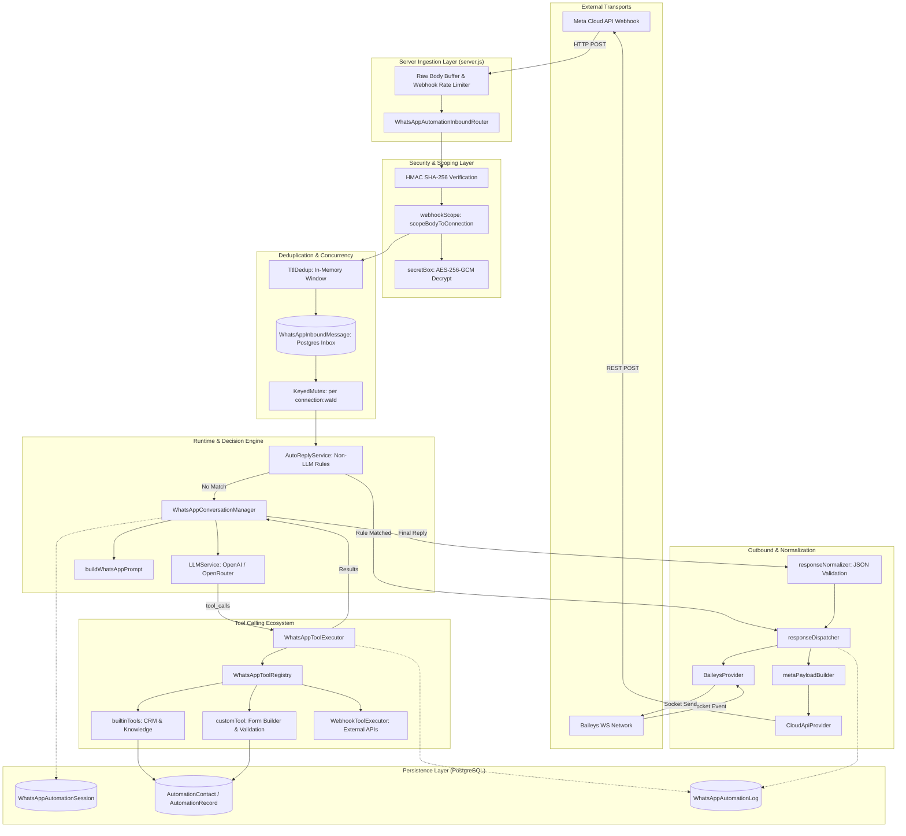

# Architecture Overview: Callify WhatsApp Automation

## 1. Executive Summary

This document provides a comprehensive technical architecture audit of the standalone WhatsApp Automation subsystem in Callify. 

Callify is a dual-channel conversational platform originally designed for real-time voice AI agents over WebSockets and telephony (Telnyx/Twilio). The WhatsApp Automation engine (`server/src/whatsappAutomation/`) represents a dedicated, text-first, multi-tenant conversational automation platform engineered to decouple messaging automations from voice agent lifecycles while maintaining unified CRM, tool calling, and persistence infrastructure.

### Architectural Tenets
- **Provider Neutrality:** The core runtime is agnostic to the WhatsApp transport layer, interfacing uniformly with **Meta WhatsApp Cloud API (v20.0)** and **Baileys (WhatsApp Web Multi-Device Socket)** via normalized abstractions.
- **AI-Native Tool Calling:** Function calling is decoupled from voice agents, using a dedicated `WhatsAppToolRegistry` and `WhatsAppToolExecutor` that support CRM mutations, database queries, custom business workflows, and outbound webhooks.
- **Durable Message Ingestion:** Employs an ACID-compliant Postgres durable inbox (`WhatsAppInboundMessage`) providing cross-instance webhook deduplication, crash recovery, and rate limiting.
- **Dedicated Multi-Tenant CRM:** Provides per-automation contact isolation, stage tracking, activity timelines, custom metadata fields, and unique reference ID generation.

---

## 2. Technology Stack & Module Breakdown

### 2.1 Technology Stack

| Layer | Technologies / Libraries | Purpose & Configuration |
|---|---|---|
| **Runtime & Framework** | Node.js (v20+ CommonJS), Express 5.2.1 | HTTP webhooks, REST administration APIs, static client hosting |
| **Database & ORM** | PostgreSQL 15+, Prisma ORM 7.9.1, `@prisma/adapter-pg`, `pg` Pool | Relational data persistence, foreign key cascading, connection pooling |
| **Messaging Transports** | Meta Graph API (v20.0 via `axios`), `@whiskeysockets/baileys` (v7.0.0-rc14) | Official Cloud API integration and unofficial WhatsApp Web socket client |
| **AI / LLM Layer** | OpenAI SDK (`openai` ^7.4.0), OpenRouter API | Streaming completions, JSON Schema tool calling, structured JSON output mode |
| **Security & Crypto** | Node.js native `crypto` (AES-256-GCM, HMAC SHA-256), `bcryptjs`, `jsonwebtoken` | Token generation, payload signature validation, encrypted credential vault |
| **Realtime / Socket** | `ws` (8.21.3) | Live session inspection, Baileys QR streaming, automation event logging |

---

## 3. Directory Layout & Module Responsibilities

The WhatsApp automation codebase is modularized within `server/src/whatsappAutomation/` and associated integration directories:

```
server/src/
├── whatsappAutomation/                 # Core WhatsApp Automation Subsystem
│   ├── index.js                        # Public module exports and initialization exports
│   ├── inboundRouter.js                # Inbound webhook ingestion, verification, & tenant scoping
│   ├── webhookScope.js                 # Helper utilities to isolate multi-tenant Meta payloads
│   ├── factory.js                      # Provider instantiation, startup synchronization & recovery
│   ├── runtime.js                      # Message processing pipeline, concurrency mutexes, auto-replies
│   ├── concurrency.js                  # In-memory KeyedMutex, TtlDedup, RateLimiter, mapLimit
│   ├── inbox.js                        # Postgres durable inbox (claim, markDone, recoverPending)
│   ├── sessionStore.js                 # Hybrid memory/DB session cache with TTL sweeping
│   ├── conversationManager.js          # Text-only LLM loop, transcript management, tool dispatch
│   ├── promptBuilder.js                # System prompt assembler (business facts, rules, JSON formats)
│   ├── autoReplyService.js             # Deterministic auto-reply engine (buttons, lists, keywords)
│   ├── responseNormalizer.js           # Untrusted LLM output parsing, JSON extraction, schema normalization
│   ├── metaPayloadBuilder.js           # Meta Graph API v20.0 JSON payload builder
│   ├── responseDispatcher.js           # Multi-provider outbound message router & text fallback handler
│   ├── channelAdapter.js               # ChannelAdapter subclass connecting runtime to dispatcher
│   ├── secretBox.js                    # AES-256-GCM encryption for stored API tokens and secrets
│   ├── logService.js                   # Structured logging service with DB persistence and WS broadcast
│   ├── routes.js                       # Express router mounted at /api/whatsapp-automation
│   └── tools/                          # WhatsApp Automation Tool Ecosystem
│       ├── index.js                    # Registry builder combining built-in, custom, & webhook tools
│       ├── WhatsAppToolRegistry.js     # Tool schema registry, argument validation, execution facade
│       ├── WhatsAppToolExecutor.js     # Tool handler execution loop, transcript updates, re-prompting
│       ├── builtinTools.js             # Contact CRM tools & general business knowledge tools
│       ├── crmService.js               # Contact, record, activity, and stage database operations
│       ├── crmRoutes.js                # REST API router mounted at /:automationId/crm
│       ├── customTool.js               # Dynamic custom form tools with transcript verification
│       └── sanitizeToolPairs.js        # History sanitizer ensuring tool_calls have matching tool results
├── integrations/
│   ├── ProviderFactory.js              # Factory creating LLMService instances
│   ├── llm/llmService.js               # OpenAI/OpenRouter chat completion client (supports tools & JSON)
│   └── whatsapp/
│       ├── CloudApiProvider.js         # Meta WhatsApp Cloud API client implementation
│       ├── baileysProvider.js          # Baileys WhatsApp Web socket client implementation
│       └── WhatsAppProvider.js         # Base abstract provider interface
├── services/
│   ├── DatabaseService.js              # PrismaClient singleton with Postgres connection pool
│   ├── BaileysInstanceManager.js       # Global singleton managing Baileys instances across server
│   └── UsageTracker.js                 # Token and tool call usage metrics accumulator
└── server.js                           # Express entry point, raw body capture middleware, mount points
```

---

## 4. End-to-End System Architecture

The following diagram illustrates the component interactions, data boundaries, and operational layers of the system:



---

## 5. Architectural Separation: Voice Agents vs. WhatsApp Automations

An essential design decision in Callify is the complete isolation between **Voice Agents** and **WhatsApp Automations**:

| Architectural Dimension | Voice Agents (`/api/agents`) | WhatsApp Automations (`/api/whatsapp-automation`) |
|---|---|---|
| **Primary Domain Model** | `model Agent` (`schema.prisma:344`) | `model WhatsAppAutomation` (`schema.prisma:7`) |
| **Media Pipeline** | Bidirectional Audio: STT (`Deepgram`), TTS (`ElevenLabs`, `Fish`, `Sarvam`) | Text and Structured JSON: Text, Button, List, Media, Flow, Location |
| **Protocol / Transport** | WebSockets (RTP audio streaming over Telnyx/Browser) | HTTP Webhooks (Meta Cloud API) / TCP Socket (Baileys) |
| **Conversation Manager** | `server/src/services/ConversationManager.js` (Audio buffers, VAD, barge-in) | `server/src/whatsappAutomation/conversationManager.js` (Text-only, turn locks) |
| **Tool Registry** | `server/src/tools/ToolRegistry.js` (Voice filler phrases, audio events) | `server/src/whatsappAutomation/tools/WhatsAppToolRegistry.js` (Text validation, CRM) |
| **Session Tracking** | `model CallSession` (`schema.prisma:412`) | `model WhatsAppAutomationSession` (`schema.prisma:119`) |
| **CRM Subsystem** | Generic `Contact` & `Booking` (`schema.prisma:440, 454`) | Dedicated `AutomationContact`, `AutomationRecord`, `AutomationActivity` (`schema.prisma:275-340`) |

### Cross-System Coupling & Legacy Remnants
Despite this structural separation, architectural inspection reveals specific leakage areas:
1. **Database Schema:** `PhoneNumber` contains both `agentId` and `whatsAppInstanceId` (`schema.prisma:380, 382`).
2. **Legacy Tables:** `WhatsAppInstance` (`schema.prisma:391`) remains in the database schema, carrying fields for `ultramsg` and legacy Meta configurations that are superseded by `WhatsAppConnection`.
3. **Baileys Routing Ambiguity:** `server/src/services/BaileysInstanceManager.js:278-340` contains dual fallback routing: it first checks for a `whatsAppConnection`, but if unconfigured, it attempts to route WhatsApp messages into voice `Agent` instances via `_routeMessageToChatbot`.

---

## 6. Cross-Cutting Architectural Concerns

### 6.1 Authentication and Tenant Boundaries
- **Admin & API Protection:** Administrative endpoints in `routes.js` use `authMiddleware` and `requireAdmin` (`middleware/auth.js`).
- **Workspace Scoping:** All operations on automations are guarded by `resolveWorkspaceId(req)` (`routes.js:105-112`).
- **Public Ingestion:** Webhook endpoints (`/api/whatsapp-automation/webhook`) bypass JWT authentication and rely strictly on Meta Hub signature verification (`X-Hub-Signature-256`) and verification challenges (`hub.verify_token`).

### 6.2 Data Security & Cryptography
- **Secrets Encryption at Rest:** Connection credentials (`apiToken`, `appSecret`) are encrypted before persistence in PostgreSQL using AES-256-GCM (`secretBox.js`). Stored tokens follow the format `enc:v1:<iv>:<tag>:<ciphertext>` in base64url encoding.
- **Timing-Safe Validation:** Meta inbound webhooks are validated using `crypto.timingSafeEqual` over the HMAC SHA-256 digest of `req.rawBody` (`CloudApiProvider.js:65`).

### 6.3 Concurrency Control Primitives
- **Per-Contact Serialization:** `KeyedMutex` (`concurrency.js:8-29`) queues concurrent messages per contact key (`${connectionId}:${contactWaId}`) ensuring race-free transcript writes.
- **Worker Pools:** Webhook message batches are throttled using `mapLimit` (`concurrency.js:32-47`) to prevent event-loop starvation during traffic bursts.
