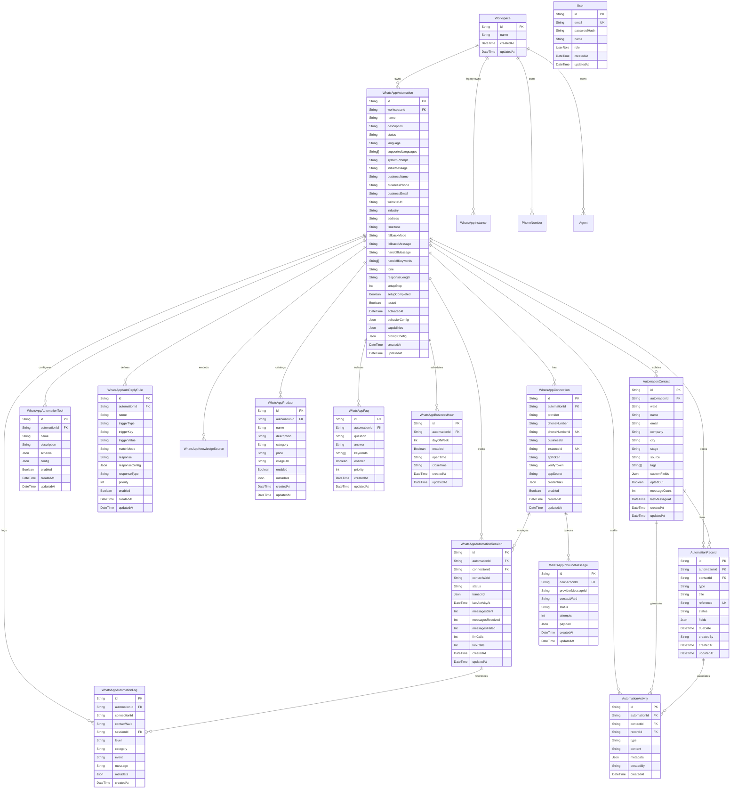

# Database Schema & Relationships Analysis

## 1. Executive Summary

The persistence architecture of the Callify WhatsApp Automation engine is built on PostgreSQL using Prisma ORM (`@prisma/client` and `prisma` ^7.9.1). The database schema encompasses multi-tenancy (`Workspace`, `User`), core automation entities (`WhatsAppAutomation`, `WhatsAppConnection`), durable queue storage (`WhatsAppInboundMessage`), conversation runtime records (`WhatsAppAutomationSession`, `WhatsAppAutomationLog`), business knowledge bases (`WhatsAppProduct`, `WhatsAppFaq`, `WhatsAppBusinessHour`, `WhatsAppKnowledgeSource`, `WhatsAppAutoReplyRule`), and an isolated automation CRM subsystem (`AutomationContact`, `AutomationRecord`, `AutomationActivity`).

This document provides a complete reference of all schemas, field types, constraints, indexes, CRUD interactions, and relationship topologies.

---

## 2. Entity-Relationship Diagram (ERD)

---

## 3. Detailed Model Definitions & Constraints

### 3.1 Multi-Tenancy & User Models

#### `User` (`schema.prisma:486-495`)
Stores user accounts for Callify authentication.
- **Fields:** `id` (UUID PK), `email` (String, Unique), `passwordHash` (String), `name` (String, Optional), `role` (Enum `UserRole`: `admin` | `user`, default: `user`), `createdAt`, `updatedAt`.
- **Architectural Note:** `User` has **no relation to `Workspace`**. It lacks a `workspaceId` foreign key, leading to workspace authorization inconsistencies documented in critical findings.

#### `Workspace` (`schema.prisma:260-271`)
Tenant root container for voice agents and WhatsApp automations.
- **Fields:** `id` (UUID PK), `name` (String), `createdAt`, `updatedAt`.
- **Relations:** 1-to-Many with `Agent`, `PhoneNumber`, `CallSession`, `WhatsAppInstance`, `WhatsAppAutomation`.

---

### 3.2 Automation Core Models

#### `WhatsAppAutomation` (`schema.prisma:7-55`)
Central entity representing a WhatsApp automated business assistant.
- **Fields:**
  - `id`: UUID (Primary Key).
  - `workspaceId`: Foreign Key referencing `Workspace.id` (`onDelete: Cascade`).
  - `name`: Business / assistant name.
  - `status`: String (`"active"`, `"paused"`, `"draft"`).
  - `language`: Primary language code (default: `"en-US"`).
  - `supportedLanguages`: Array of supported language codes (`String[]`).
  - `systemPrompt`: Base system instructions for the LLM.
  - `initialMessage`: Welcome greeting sent to new contacts.
  - Business Info: `businessName`, `businessPhone`, `businessEmail`, `websiteUrl`, `industry`, `address`, `timezone` (default: `"Asia/Kolkata"`).
  - Behavior Settings: `fallbackMode`, `fallbackMessage`, `handoffMessage`, `handoffKeywords` (`String[]`), `tone`, `responseLength`.
  - Config Blobs: `behaviorConfig` (JSON), `capabilities` (JSON), `promptConfig` (JSON).
  - Audit: `setupStep` (Int), `setupCompleted` (Boolean), `tested` (Boolean), `activatedAt` (DateTime), `createdAt`, `updatedAt`.
- **Indexes:** `@@index([workspaceId, status])`.

#### `WhatsAppConnection` (`schema.prisma:57-81`)
Represents a physical WhatsApp account connected to an automation.
- **Fields:**
  - `id`: UUID (Primary Key).
  - `automationId`: Foreign Key referencing `WhatsAppAutomation.id` (`onDelete: Cascade`).
  - `provider`: Provider type (`"cloud_api"`, `"baileys"`, `"meta"`).
  - `phoneNumber`: Business phone number (E.164).
  - `phoneNumberId`: Meta Graph API Phone Number ID (Unique).
  - `businessId`: Meta WhatsApp Business Account (WABA) ID.
  - `instanceId`: Baileys instance ID (Unique).
  - `apiToken`, `appSecret`: Encrypted credentials (stored via `secretBox.js`).
  - `verifyToken`: Verification token for Meta webhook handshakes.
  - `credentials`: JSON configuration blob.
  - `enabled`: Boolean (default: `true`).
- **Constraints & Indexes:**
  - `@@unique([automationId, phoneNumber])`: Prevents attaching the same phone number to the same automation twice.
  - `@@unique([phoneNumberId])`: Ensures global uniqueness for Meta phone number routing.
  - `@@unique([instanceId])`: Ensures global uniqueness for Baileys instances.
  - `@@index([provider, enabled])`.

#### `WhatsAppInboundMessage` (`schema.prisma:85-101`)
Durable queue table guaranteeing at-least-once message delivery and deduplication.
- **Fields:**
  - `id`: UUID (Primary Key).
  - `connectionId`: Foreign Key referencing `WhatsAppConnection.id` (`onDelete: Cascade`).
  - `providerMessageId`: Message ID from provider (`wamid.xxx` or Baileys ID).
  - `contactWaId`: Sender phone number / WhatsApp ID.
  - `status`: Message lifecycle status (`"pending"`, `"done"`, `"failed"`, `"dropped"`).
  - `attempts`: Replay attempt counter (default: 0, capped by `WHATSAPP_INBOX_MAX_ATTEMPTS`).
  - `payload`: Complete JSON webhook message body.
- **Constraints & Indexes:**
  - `@@unique([connectionId, providerMessageId])`: Prevents duplicate ingestion across server instances and restarts.
  - `@@index([status, updatedAt])`: Optimizes polling for crashed pending messages during crash recovery.
  - `@@index([connectionId, contactWaId, createdAt])`: Optimizes DB-backed per-contact rate limiting queries.

---

### 3.3 Session, Logging & Tool Models

#### `WhatsAppAutomationSession` (`schema.prisma:119-144`)
Maintains conversation state and rolling message counts per customer.
- **Fields:**
  - `id`: UUID (Primary Key).
  - `automationId`: Foreign Key referencing `WhatsAppAutomation.id` (`onDelete: Cascade`).
  - `connectionId`: Foreign Key referencing `WhatsAppConnection.id` (`onDelete: Cascade`).
  - `contactWaId`: Customer WhatsApp ID.
  - `status`: String (`"active"`, `"human_handoff"`).
  - `transcript`: JSON array containing conversation history (user, assistant, tool turns).
  - `lastActivityAt`: Timestamp of latest message (used for in-memory sweeping and TTL).
  - Counters: `messagesSent`, `messagesReceived`, `messagesFailed`, `llmCalls`, `toolCalls`.
- **Constraints & Indexes:**
  - `@@unique([connectionId, contactWaId])`: Exactly one active session row per customer connection.
  - `@@index([automationId, status])`.

#### `WhatsAppAutomationLog` (`schema.prisma:145-164`)
Structured event audit log for automation executions.
- **Fields:**
  - `id`: UUID (Primary Key).
  - `automationId`: Foreign Key referencing `WhatsAppAutomation.id` (`onDelete: Cascade`).
  - `connectionId`: String (Nullable).
  - `contactWaId`: String (Nullable).
  - `sessionId`: Foreign Key referencing `WhatsAppAutomationSession.id` (`onDelete: SetNull`).
  - `level`: `"info"`, `"warn"`, `"error"`, `"debug"`.
  - `category`: `"system"`, `"message"`, `"tool"`, `"auto_reply"`, `"llm"`, `"error"`, `"status"`.
  - `event`, `message`: String event descriptors.
  - `metadata`: JSON payload.
- **Indexes:** `@@index([automationId, createdAt])`, `@@index([automationId, category])`, `@@index([sessionId, createdAt])`.

#### `WhatsAppAutomationTool` (`schema.prisma:103-117`)
Tenant-configured tool schemas and execution definitions.
- **Fields:** `id`, `automationId`, `name`, `description`, `schema` (JSON), `config` (JSON), `enabled` (Boolean).
- **Constraints:** `@@unique([automationId, name])`.

#### `WhatsAppAutoReplyRule` (`schema.prisma:166-186`)
Deterministic non-LLM auto-reply rules.
- **Fields:** `id`, `automationId`, `name`, `triggerType` (`button_press`, `list_row`, `keyword`, `flow_reply`, `first_message`, `always`), `triggerKey`, `triggerValue`, `matchMode` (`exact`, `contains`, `regex`, `prefix`), `response`, `responseConfig` (JSON), `responseType`, `priority` (Int), `enabled` (Boolean).
- **Constraints & Indexes:** `@@unique([automationId, triggerType, triggerKey])`, `@@index([automationId, enabled])`.

---

### 3.4 Knowledge Base Models

| Model | Schema Lines | Key Fields | Constraints / Indexes |
|---|---|---|---|
| `WhatsAppProduct` | 207-223 | `id`, `automationId`, `name`, `description`, `category`, `price`, `imageUrl`, `enabled`, `metadata` | `@@index([automationId, enabled])` |
| `WhatsAppFaq` | 225-239 | `id`, `automationId`, `question`, `answer`, `keywords` (`String[]`), `enabled`, `priority` | `@@index([automationId, enabled, priority])` |
| `WhatsAppBusinessHour` | 241-254 | `id`, `automationId`, `dayOfWeek` (0–6), `enabled`, `openTime`, `closeTime` | `@@unique([automationId, dayOfWeek])` |
| `WhatsAppKnowledgeSource` | 188-205 | `id`, `automationId`, `type`, `title`, `content`, `sourceUrl`, `enabled`, `metadata` | `@@index([automationId, enabled])` |

---

### 3.5 Automation CRM Models

The Automation CRM provides tenant-isolated customer records independent of the voice CRM.

#### `AutomationContact` (`schema.prisma:275-299`)
- **Fields:**
  - `id`: UUID (Primary Key).
  - `automationId`: Foreign Key referencing `WhatsAppAutomation.id` (`onDelete: Cascade`).
  - `waId`: Customer WhatsApp ID (Phone digits).
  - `name`, `email`, `company`, `city`: Contact profile details.
  - `stage`: Sales pipeline stage (default: `"new"`; values: `"new"`, `"contacted"`, `"qualified"`, `"proposal"`, `"won"`, `"lost"`).
  - `source`: Lead source (default: `"whatsapp"`).
  - `tags`: Tag labels (`String[]`).
  - `customFields`: Dynamic key-value pairs stored as JSON.
  - `optedOut`: Opt-out compliance flag (default: `false`).
  - `messageCount`: Total messages exchanged.
  - `lastMessageAt`: Timestamp of last contact communication.
- **Constraints & Indexes:**
  - `@@unique([automationId, waId])`: Isolates contacts per automation; customer records never merge across different automations.
  - `@@index([automationId, stage])`: Optimizes CRM pipeline kanban filtering.

#### `AutomationRecord` (`schema.prisma:320-340`)
Stores business requests, bookings, leads, complaints, and service tickets.
- **Fields:**
  - `id`: UUID (Primary Key).
  - `automationId`: Foreign Key referencing `WhatsAppAutomation.id` (`onDelete: Cascade`).
  - `contactId`: Foreign Key referencing `AutomationContact.id` (`onDelete: Cascade`).
  - `type`: Record classification (e.g., `"booking"`, `"lead"`, `"complaint"`, `"callback"`).
  - `title`: Short summary.
  - `reference`: Human-readable tracking code (e.g., `"BOO-JK6T9"`, `"REQ-8A2F1"`).
  - `status`: Lifecycle status (default: `"open"`; values: `"open"`, `"done"`, `"cancelled"`).
  - `fields`: Arbitrary structured form data (JSON).
  - `dueDate`: Scheduled time or fulfillment deadline (DateTime).
  - `createdBy`: Author identifier (`"ai"` or `"user"`).
- **Constraints & Indexes:**
  - `reference String @unique`: **Global unique constraint** across the entire database table.
  - `@@index([automationId, type, status])`: Optimizes record filtering by workflow status.
  - `@@index([contactId])`: Enables fast lookup of customer history.

#### `AutomationActivity` (`schema.prisma:301-318`)
Immutable timeline log of customer interactions and state transitions.
- **Fields:** `id`, `automationId`, `contactId`, `recordId` (Nullable, `onDelete: SetNull`), `type` (`"note"`, `"stage_change"`, `"update"`, `"tags"`, `"record_created"`, `"record_updated"`, `"handoff"`, `"message"`), `content` (String <= 2000 chars), `metadata` (JSON), `createdBy` (`"ai"` | `"user"`), `createdAt`.
- **Indexes:** `@@index([contactId, createdAt])`, `@@index([automationId, type])`.

---

## 4. CRUD Operations & Data Lifecycle Matrix

| Table | Created By | Read By | Updated By | Deleted By |
|---|---|---|---|---|
| `WhatsAppAutomation` | `POST /api/whatsapp-automation` (`routes.js:180`) | `GET /` and `GET /:automationId` (`routes.js:150, 290`) | `PUT /:automationId` (`routes.js:332`) | `DELETE /:automationId` (`routes.js:383`) |
| `WhatsAppConnection` | `POST /:automationId/connections` (`routes.js:412`) | Inbound Router, Routes, Status Check | `PUT /:automationId/connections/:id` (`routes.js:475`) | `DELETE /:automationId/connections/:id` (`routes.js:492`) |
| `WhatsAppInboundMessage` | `inbox.claim()` (`inbox.js:22`) | `inbox.countRecent()`, `inbox.recoverPending()` | `inbox.finish()` (`markDone`/`markDropped`), `recoverPending()` | `inbox.purge()` (Older than 7 days) |
| `WhatsAppAutomationSession` | `store.set()` upsert (`sessionStore.js:56`) | `store.load()` (`sessionStore.js:29`), Routes stats | `store.set()` (transcript updates), Counter increments | Cascade delete with `WhatsAppAutomation` |
| `WhatsAppAutomationLog` | `logService._write()` (`logService.js:66`) | `logService.query()`, `logService.stats()` | None (Append-only) | Cascade delete with `WhatsAppAutomation` |
| `AutomationContact` | `crm.ensureContact()` (`crmService.js:30`) | `crm.getProfile()`, `crmRoutes` GET contacts | `crm.updateContact()`, `crm.setStage()`, `crm.changeTags()` | Cascade delete with `WhatsAppAutomation` |
| `AutomationRecord` | `crm.createRecord()` (`crmService.js:116`) | `crm.getRecordByReference()`, `crm.listRecords()` | `crm.updateRecordStatus()` (`crmService.js:130`) | Cascade delete with `WhatsAppAutomation` |
| `AutomationActivity` | `crm.logActivity()` (`crmService.js:50`) | `crm.getProfile()`, Contact details view | None (Append-only audit trail) | Cascade delete with `WhatsAppAutomation` |
