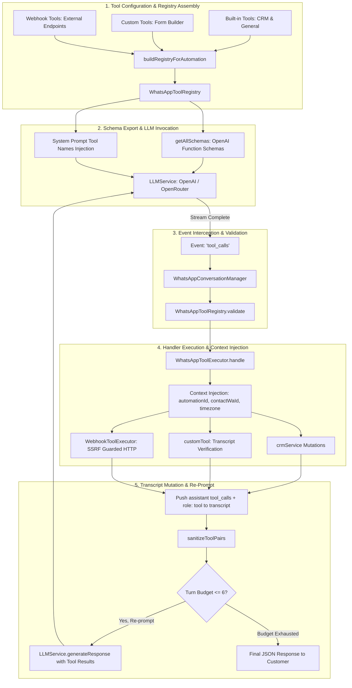

# AI Tool Calling Architecture & Analysis

## 1. Executive Summary

Tool calling in the Callify WhatsApp automation engine is governed by a standalone, deterministic execution framework residing in `server/src/whatsappAutomation/tools/`. Unlike the voice pipeline—which manages streaming audio filler phrases, barge-in interruptions, and voice-state machines—the WhatsApp tool framework operates as an atomic, multi-round request/response loop designed for structured data extraction, CRM updates, catalog searches, and business transactions.

The subsystem enforces strict boundaries:
- **Zero Hallucination Tolerance:** The LLM cannot invoke tools not present in the registry, and handlers reject unconfirmed arguments.
- **Transcript Integrity:** OpenAI/Anthropic APIs require every `tool_calls` assistant turn to be immediately matched by corresponding `tool` response messages. The system includes pre-generation sanitization.
- **Anti-Hallucination Transcript Auditing:** Custom tools programmatically inspect prior conversation messages to verify that customers actually provided the extracted names, dates, or addresses before database mutations occur.

---

## 2. Tool Lifecycle & Architecture Diagram



---

## 3. Tool Registration & Schema Generation

### 3.1 Registry Assembly
- **File:** `server/src/whatsappAutomation/tools/index.js:10-28`
- **Function:** `buildRegistryForAutomation(automation)`
- When a contact session starts (`runtime.js:75`), a fresh `WhatsAppToolRegistry` is constructed specifically for the automation tenant:
  1. **Disabled Filtering:** Inspects `automation.tools` array. Tools explicitly marked `enabled: false` are added to a `disabled` set (`tools/index.js:12`).
  2. **Built-in Registration:** Calls `registerBuiltInTools(registry, { disabled })` (`builtinTools.js:277-282`), mounting contact CRM and general knowledge tools.
  3. **Custom Tool Registration:** Iterates custom tool configurations (`tool.config?.type === 'custom'`), building dynamic form definitions via `buildCustomTool(...)` (`customTool.js:35-209`).
  4. **Webhook Tool Registration:** Iterates webhook definitions (`tool.config?.type === 'webhook'`), mounting them via `registry.registerWebhook(...)` (`WhatsAppToolRegistry.js:27-36`).

### 3.2 Schema Export
- **File:** `server/src/whatsappAutomation/tools/WhatsAppToolRegistry.js:49-54`
- Conforms strictly to the OpenAI Function Calling schema:
```javascript
getAllSchemas() {
  return [...this._tools.values()].map((tool) => ({
    type: 'function',
    function: {
      name: tool.name,
      description: tool.description,
      parameters: tool.parameters,
    },
  }));
}
```

---

## 4. Argument Validation & Execution Mechanics

### 4.1 Schema Validation Facade
- **File:** `server/src/whatsappAutomation/tools/WhatsAppToolRegistry.js:57-69`
- Before invoking any handler, `validate(name, args)` executes synchronous schema enforcement:
  1. **Tool Existence:** Rejects unknown or hallucinated tool names with: `Tool "${name}" is not available`.
  2. **Required Fields:** Checks `parameters.required || []`. If any required key is `undefined`, `null`, or an empty string, execution aborts early with: `Missing required argument(s): ${missing.join(', ')}`.
  3. **Enum Validation:** If the parameter specifies an `enum` array, validates `spec.enum.includes(value)`. Rejects invalid values with allowed values enumerated.

### 4.2 Context Injection & Handler Invocation
- **File:** `server/src/whatsappAutomation/tools/WhatsAppToolExecutor.js:7-27, 47`
- Tools are executed with a persistent conversation context:
```javascript
this.context = {
  transcript,
  getRecentTranscript,
  automationId,
  sessionId,
  contactWaId,
  contactName,
  contactProvider,
  connectionId,
  workspaceId,
  timezone,
  onHandoff: () => this.handoffToHuman(),
};
```
- The executor invokes `this.registry.execute(toolName, args, this.context)`. If an uncaught exception occurs, it returns `{ success: false, error: error.message, message: 'The action failed. Do not claim it succeeded.' }` to prevent the LLM from falsely hallucinating that an action succeeded (`WhatsAppToolExecutor.js:50`).

### 4.3 Multi-Turn Re-prompting & Budget Throttling
- **File:** `server/src/whatsappAutomation/tools/WhatsAppToolExecutor.js:83-97`
- **Re-prompting:** After pushing the execution result into the transcript, the executor checks `shouldReprompt`. If true, it re-prompts the LLM with the updated transcript so the model can generate a conversational response referencing the tool result.
- **Turn Budget:** Tracks `this.rounds`. If `rounds > maxRoundsPerTurn` (default 6), `exhausted` is set to `true`:
  - Disables further tool calls by passing `tools: []` and `tool_choice: 'none'`.
  - Forces the model to return a text response, preventing infinite tool execution loops.

### 4.4 Transcript Sanitization
- **File:** `server/src/whatsappAutomation/tools/sanitizeToolPairs.js:7-30`
- External LLM providers (OpenAI, Anthropic) throw fatal HTTP 400 errors if an assistant message with `tool_calls` is not immediately followed by matching `role: 'tool'` messages with identical `tool_call_id` values.
- `sanitizeToolPairs(messages)` runs before every LLM completion request (`conversationManager.js:202`):
  - Validates that every `tool_call_id` in an assistant message has a matching response.
  - Removes orphan `tool` messages whose assistant call was pruned by context window limits.

---

## 5. Comprehensive Analysis of Built-in Tools

### 5.1 CRM Contact Tools (`builtinTools.js:30-140`)

| Tool Name | Parameters | Purpose | Side Effects / DB Operations |
|---|---|---|---|
| `crm_get_contact` | None | Retrieves customer profile (name, email, company, city, customFields, tags, stage, open records). | `crmService.getProfile()` queries `AutomationContact`, recent `AutomationActivity`, and `AutomationRecord`. |
| `crm_update_contact` | `name`, `email`, `company`, `city`, `customFields` (object) | Saves verified customer details. | Updates `AutomationContact`; logs `AutomationActivity` (`type: 'update'`). Merges `customFields` JSON. |
| `crm_set_stage` | `stage` (enum: `new`, `contacted`, `qualified`, `proposal`, `won`, `lost`), `reason` (string) | Advances lead through sales pipeline. | Updates `AutomationContact.stage`; logs `AutomationActivity` (`type: 'stage_change'`). |
| `crm_update_tags` | `add` (string[]), `remove` (string[]) | Tags contact for segmentation. | Modifies `AutomationContact.tags` array; logs `AutomationActivity`. |
| `crm_add_note` | `note` (string) | Records internal notes on timeline. | Inserts `AutomationActivity` (`type: 'note'`, `createdBy: 'ai'`). Hidden from customer. |
| `crm_create_record` | `title`, `type`, `fields` (object), `dueDate` (ISO string) | Creates lead, booking, complaint, or request. | Inserts `AutomationRecord` with backend reference ID; logs `AutomationActivity`. |
| `crm_list_records` | None | Lists open records for current customer. | Queries `AutomationRecord` where `contactId = currentContact` and `status = 'open'`. |
| `crm_change_record_status` | `reference` (string), `status` (string) | Updates record lifecycle (e.g. `done`, `cancelled`). | Updates `AutomationRecord.status`; logs `AutomationActivity`. |

### 5.2 General Business Tools (`builtinTools.js:142-273`)

| Tool Name | Parameters | Purpose | Side Effects / Logic |
|---|---|---|---|
| `get_current_datetime` | None | Resolves relative times ("tomorrow", "next Friday"). | Computes localized ISO time and day of week using `Intl.DateTimeFormat` with `ctx.timezone`. |
| `get_business_hours` | None | Checks if business is open right now. | Queries `WhatsAppBusinessHour` for `automationId`, compares current time against `openTime` and `closeTime`. |
| `search_products` | `query` (optional string) | Searches catalog items and prices. | Queries `WhatsAppProduct` (`enabled: true`) with case-insensitive `contains` over `name`, `description`, `category`. |
| `search_faq` | `query` (string) | Searches knowledge FAQs. | Queries `WhatsAppFaq`, performs keyword matching against `question` and `keywords`, returns top 3 scored answers. |
| `check_request_status` | `reference` (string) | Checks status of a booking or complaint. | Calls `crm.getRecordByReference(args.reference)`. Returns status, title, type, dueDate. |
| `check_my_requests` | None | Lists all open requests for current contact. | Queries `AutomationRecord` for `contactId` where `status = 'open'`. |
| `request_human_handoff` | `reason` (string) | Escalates chat to a human agent. | Logs handoff in `AutomationActivity`, creates `callback` record, invokes `ctx.onHandoff()`, sets `status = 'human_handoff'`. |

---

## 6. Custom Tool Builder (`customTool.js`)

The Custom Tool engine (`buildCustomTool`) generates dynamic function tools configured by business users through the UI. It introduces deep anti-hallucination safeguards:

### Anti-Hallucination & Transcript Verification Pipeline
When an LLM attempts to execute a custom tool (e.g., `book_demo` with fields `name`, `email`, `preferred_time`):

1. **Mandatory Field Check:** Validates that arguments contain non-empty strings for all required fields (`customTool.js:62-76`).
2. **Explicit Confirmation Flag:** Tools inject a hidden schema property `user_confirmed: { type: "boolean" }`. If `false`, execution is rejected with error `NOT_CONFIRMED` (`customTool.js:79-85`).
3. **Transcript Memory Audit (`customTool.js:88-154`):**
   - The executor inspects `ctx.getRecentTranscript()`.
   - **Name & Address Verification:** Verifies that the customer actually stated the name and address in prior user messages or profile metadata. If the LLM hallucinated a name or address not present in the chat history, execution is aborted with error `UNPROVIDED_CUSTOMER_DETAILS` (`customTool.js:132`).
   - **Time Words Verification:** If `askWhen: true`, validates that time-related words (e.g. `today`, `tomorrow`, `pm`, date formats) appear in the user utterances (`customTool.js:121-127`).
   - **Confirmation Prompt Audit:** Scans prior assistant messages to ensure the AI explicitly asked for confirmation, and checks the last user message for affirmation words (`yes`, `sure`, `ok`, `confirm`, `proceed`) (`customTool.js:144-152`).
4. **CRM Record Generation:** On successful validation, writes the lead/booking to `AutomationRecord`, generates a reference ID, and updates the contact's stage in the CRM.

---

## 7. Outbound Webhook Tool Execution (`WebhookToolExecutor.js`)

For integrations with external HTTP APIs (e.g., Cal.com, custom webhooks, ERPs), `executeWebhookTool` runs outbound HTTP requests:

- **Security & SSRF Mitigation (`urlGuard.js`):** Webhook URLs are validated using `assertHttpUrl` and `resolveSafeHost`, preventing SSRF attacks against internal network endpoints (`127.0.0.1`, `169.254.169.254`, private IP subnets).
- **Environment Variable Allowlisting:** Headers and URL templates supporting `{{VAR_NAME}}` tokens are restricted by `isEnvVarAllowed` (`WebhookToolExecutor.js:35-39`), permitting only variables prefixed with `TOOL_` or `WEBHOOK_TOOL_` or listed in `WEBHOOK_ENV_ALLOWLIST`.
- **Parameter & Static Mapping:** Supports renaming flat LLM arguments into nested dot-notation paths (`paramMapping`) and injecting constant payload headers (`staticBody`) (`WebhookToolExecutor.js:77-100`).
- **Response Capping:** Outbound responses are capped at `MAX_RESPONSE_BYTES = 256KB` to prevent buffer overflow attacks from untrusted external APIs.
