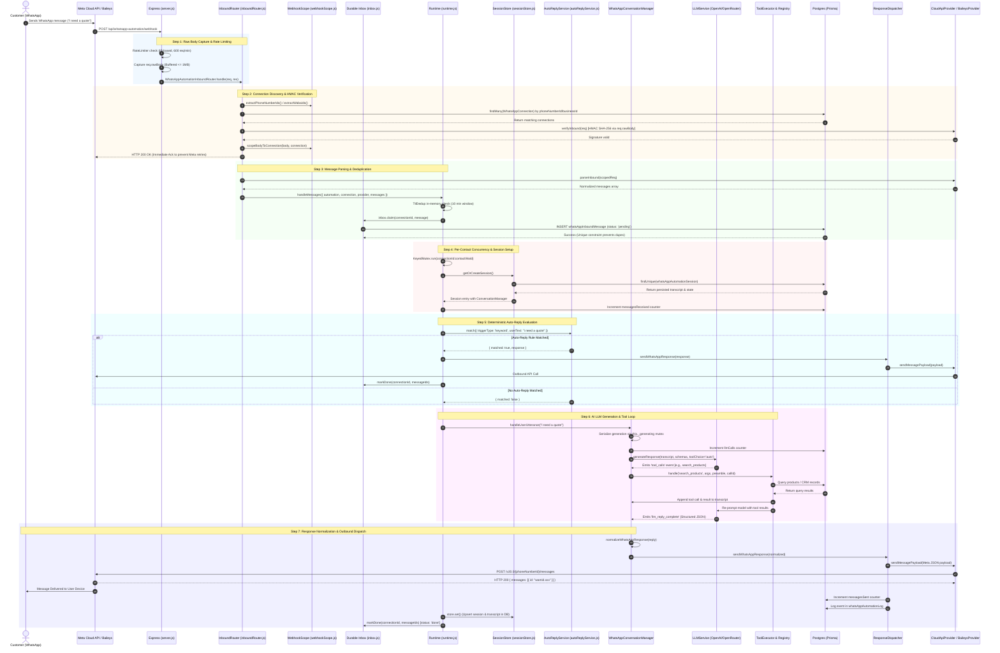

# WhatsApp Execution Flow: Inbound to Outbound Trace

## 1. Overview

This document provides a line-by-line architectural execution trace of incoming WhatsApp messages through the Callify automation runtime. It follows an incoming HTTP webhook from Meta (and alternatively, a raw TCP event from Baileys) through verification, deduplication, auto-reply matching, AI conversation management, tool execution, output normalization, and final outbound dispatch.

---

## 2. End-to-End Sequence Diagram

---

## 3. Step-by-Step Execution Trace

### Step 1: Webhook Ingestion & Raw Body Buffering
- **Entry File:** `server/server.js:23-55`
- **Mechanism:**
  - Before the standard Express JSON parser runs, a specialized streaming capture middleware intercepts all `POST` requests targeted at `/api/whatsapp-automation/webhook` and `/api/whatsapp/webhook` (`server.js:25`).
  - **Rate Limiting:** A `RateLimiter` (`concurrency.js:78`) validates that the incoming IP has not exceeded `WEBHOOK_RATE_LIMIT` (default 600 requests per minute) (`server.js:26`).
  - **Raw Stream Capture:** The raw HTTP payload is buffered as a UTF-8 string into `req.rawBody` (`server.js:39`) capped at 1MB (`MAX_WEBHOOK_BODY_BYTES = 1024 * 1024`). The raw string is parsed into `req.body` using `JSON.parse`. Preserving the untouched byte string in `req.rawBody` is mandatory for cryptographic signature validation.
  - The request is delegated to `WhatsAppAutomationInboundRouter.handle(req, res)` (`server.js:52-54`).

### Step 2: Verification, Tenant Resolution & Payload Scoping
- **Files:** `server/src/whatsappAutomation/inboundRouter.js:35-121`, `server/src/whatsappAutomation/webhookScope.js:8-74`
- **GET Webhook Verification:**
  - When Meta registers a webhook, it issues an HTTP GET with query parameters `hub.mode=subscribe`, `hub.verify_token`, and `hub.challenge` (`inboundRouter.js:37-40`).
  - `inboundRouter.js:42-55` looks up active `WhatsAppConnection` rows matching the token or falls back to `process.env.WHATSAPP_VERIFY_TOKEN`. If valid, it responds with HTTP 200 and the raw challenge string.
- **POST Inbound Routing & Connection Discovery:**
  - If a specific connection is requested via URL parameter (`/webhook/:connectionId`), `inboundRouter.js:65-70` loads that connection directly.
  - Otherwise, `findConnectionsForPayload(body)` (`inboundRouter.js:8-27`) extracts all `phone_number_id` values from the payload using `extractPhoneNumberIds(body)` (`webhookScope.js:24-31`) and queries `dbService.prisma.whatsAppConnection.findMany({ where: { phoneNumberId, enabled: true } })`.
  - If no phone number ID matches, it extracts WABA IDs via `extractWabaIds(body)` (`webhookScope.js:33-41`) and queries by `businessId`.
- **HMAC Signature Verification:**
  - For each matched connection, `createWhatsAppAutomationProvider(connection)` constructs a `CloudApiProvider` (`inboundRouter.js:86`).
  - `CloudApiProvider.verifyInbound(req)` (`CloudApiProvider.js:53-69`) extracts `req.headers['x-hub-signature-256']` and computes `crypto.createHmac('sha256', this.appSecret).update(req.rawBody).digest('hex')`.
  - It compares the signatures using `crypto.timingSafeEqual` (`CloudApiProvider.js:65`). If invalid, the connection is dropped.
- **Payload Scoping:**
  - In multi-tenant environments where Meta batches changes for multiple numbers into a single payload, `scopeBodyToConnection(body, connection)` (`webhookScope.js:49-64`) filters out changes belonging to other phone numbers, preventing cross-tenant leakage.
- **Immediate Acknowledgment:**
  - `inboundRouter.js:100` executes `res.status(200).send('OK')`. Meta requires a fast HTTP 200 response (within 3 seconds) to prevent automatic webhook retries while LLM and tool calls execute asynchronously.

### Step 3: Message Parsing, Deduplication & Inbox Claim
- **Files:** `server/src/whatsappAutomation/inboundRouter.js:109-112`, `server/src/whatsappAutomation/runtime.js:125-149`, `server/src/whatsappAutomation/inbox.js:20-35`
- **Parsing:**
  - `provider.parseInbound(scopedReq)` (`CloudApiProvider.js:79-221`) converts Meta's nested webhook JSON into standardized internal message objects containing `providerMessageId`, `from` (clean sender digits), `type` (text, interactive_response, location, image, etc.), and `timestamp`.
- **In-Memory Deduplication:**
  - `processedMessages.seen(`${connection.id}:${dedupId}`)` (`concurrency.js:57-65`, `runtime.js:136`) checks a memory ring-buffer with a 10-minute TTL to quickly drop immediate duplicate deliveries.
- **Durable Postgres Inbox Claim:**
  - If not in memory, the message is claimed in PostgreSQL via `inbox.claim(connection.id, message)` (`inbox.js:20-35`).
  - Executes `prisma.whatsAppInboundMessage.create(...)` with composite unique constraint `@@unique([connectionId, providerMessageId])`.
  - If another process or server instance has already claimed the message, PostgreSQL returns error code `P2002` (Unique constraint violation), and `inbox.claim` returns `false`, gracefully dropping the duplicate (`inbox.js:32`).

### Step 4: Per-Contact Concurrency & Session Management
- **Files:** `server/src/whatsappAutomation/runtime.js:166-180`, `server/src/whatsappAutomation/concurrency.js:8-29`, `server/src/whatsappAutomation/sessionStore.js:23-65`
- **Per-Contact Mutex:**
  - Incoming messages are grouped by sender (`message.from`).
  - `sessionMutex.run(`${connection.id}:${contactWaId}`, ...)` (`runtime.js:166`) ensures all messages from the same customer are processed strictly in series, eliminating race conditions on the transcript and LLM abort controllers.
- **Inbound Rate Limiting:**
  - `_allowContact(...)` checks recent inbound counts in `WhatsAppInboundMessage` within a 60-second window against `WHATSAPP_CONTACT_RATE_LIMIT` (default 30) (`runtime.js:168, 282-291`).
- **Session Retrieval & Instantiation:**
  - `getOrCreateSession(...)` (`runtime.js:63-122`) first checks the in-memory cache `store.get(connection.id, contactWaId)` (`sessionStore.js:23-27`).
  - If not in memory, it queries PostgreSQL via `store.load(...)` (`sessionStore.js:28-42`) from `WhatsAppAutomationSession`.
  - Initializes `WhatsAppAutomationChannelAdapter` and `WhatsAppConversationManager`.
  - Builds the automation-specific tool registry via `buildRegistryForAutomation(automation)` (`tools/index.js:10-28`).
  - Generates the customized system prompt via `buildWhatsAppPrompt(automation, ...)` (`promptBuilder.js:83`).
  - Injects conversation context into the tool executor (`automationId`, `workspaceId`, `contactWaId`, `timezone`).

### Step 5: Auto-Reply Rule Evaluation (Pre-LLM)
- **Files:** `server/src/whatsappAutomation/runtime.js:213-230`, `server/src/whatsappAutomation/autoReplyService.js:63-164`
- **Deterministic Interception:**
  - Before incurring LLM inference latency or cost, `_checkAutoReply(...)` passes the message to `AutoReplyService`.
  - Evaluates rules loaded from `WhatsAppAutoReplyRule` ordered by `priority ASC`.
  - Supported triggers:
    - `button_press`: matches button IDs clicked by the user.
    - `list_row`: matches list menu selection IDs.
    - `keyword`: matches user text via `exact`, `contains`, `prefix`, or `regex` (`autoReplyService.js:18-29`).
    - `first_message`: triggered on the very first incoming contact message.
  - If a rule matches:
    - Evaluates attachments (probes external URLs via `probeMediaUrl`, `autoReplyService.js:39-61`).
    - Dispatches the preconfigured response directly to `entry.adapter.sendResponse(response)`.
    - Increments `messagesSent` counter and updates `WhatsAppAutomationLog`.
    - Skips LLM generation entirely (`runtime.js:228`).

### Step 6: AI Conversation & Tool Execution Loop
- **Files:** `server/src/whatsappAutomation/conversationManager.js:133-185`, `server/src/whatsappAutomation/tools/WhatsAppToolExecutor.js:31-97`, `server/src/integrations/llm/llmService.js:53-205`
- **Transcript Serialization:**
  - `WhatsAppConversationManager.handleUserUtterance(text)` manages an internal `this._generating` promise lock (`conversationManager.js:146-151`), ensuring concurrent utterances wait for active tool re-prompts to complete.
  - Appends `{ role: 'user', content: text }` to `this.transcript`.
- **LLM Completion Generation:**
  - Calls `llm.generateResponse(...)` with sanitized transcript history, OpenAI tool schemas, and `toolChoice: 'auto'`.
  - `llmService.js:85-88` sets `response_format = { type: "json_object" }` (enabled by `llm.setJsonMode(true)` in `conversationManager.js:18`) to ensure structured JSON output.
- **Tool Calling Event & Execution:**
  - If the model emits tool calls, `llmService.js:182` fires the `'tool_calls'` event with an array of parsed calls.
  - `conversationManager.js:89-110` intercepts the event and delegates each call to `WhatsAppToolExecutor.handle(toolName, args, preamble, callId, shouldReprompt)`.
  - `WhatsAppToolExecutor`:
    - Validates required arguments against the schema via `registry.validate(toolName, args)` (`WhatsAppToolRegistry.js:57-69`).
    - Executes the handler: built-in CRM methods (`crmService.js`), custom tools (`customTool.js`), or external webhooks (`WebhookToolExecutor.js`).
    - Appends both the assistant call and the tool execution result to `this.transcript` (`WhatsAppToolExecutor.js:56-63`).
    - If `shouldReprompt` is true, re-prompts the LLM with the updated transcript (`WhatsAppToolExecutor.js:90-96`) up to `maxRoundsPerTurn = 6`.

### Step 7: Output Normalization, Outbound Dispatch & Cleanup
- **Files:** `server/src/whatsappAutomation/conversationManager.js:61-87`, `server/src/whatsappAutomation/responseNormalizer.js:116-200`, `server/src/whatsappAutomation/responseDispatcher.js:73-267`, `server/src/whatsappAutomation/metaPayloadBuilder.js:43-180`
- **Response Normalization:**
  - Once the LLM completes its text response, `llm_reply_complete` fires.
  - `normalizeWhatsAppResponse(reply)` (`responseNormalizer.js:116`) parses the raw LLM string, strips markdown fences, validates `_type` (`text`, `button`, `list`, `cta_url`, `media`, `template`, `flow`, `location`, `handoff`), and verifies length limits (e.g., button titles <= 20 chars, list titles <= 24 chars).
- **Outbound Dispatch:**
  - `WhatsAppChannelAdapter.sendResponse(normalized)` forwards the response to `responseDispatcher.sendWhatsAppResponse(...)`.
  - For `CloudApiProvider`, calls `sendMetaCloudResponse(...)` which uses `buildMetaPayload(...)` (`metaPayloadBuilder.js:43`) to construct Meta's official Graph API payload.
  - `CloudApiProvider._post('/{phoneNumberId}/messages', payload)` (`CloudApiProvider.js:272-301`) transmits the payload to `https://graph.facebook.com/v20.0/{phoneNumberId}/messages` with exponential backoff on retriable HTTP 429/5xx errors (`CloudApiProvider.js:257-270`).
  - If Meta rejects a rich interactive message, `responseDispatcher.js:243-259` automatically falls back to sending extracted plain text.
- **Session Persistence & Inbox Finalization:**
  - `runtime.js:267` calls `store.set(connection, automation, contactWaId, entry)`.
  - `sessionStore.js:56-60` upserts `WhatsAppAutomationSession` in PostgreSQL with the updated transcript and timestamp.
  - `inbox.markDone(connection.id, messageIds)` (`inbox.js:46`) updates the message status to `'done'` in `WhatsAppInboundMessage`.

---

## 4. Delivery Status Updates

- **Files:** `server/src/integrations/whatsapp/CloudApiProvider.js:229-250`, `server/src/whatsappAutomation/inboundRouter.js:127-139`
- Meta transmits status webhooks when messages are `sent`, `delivered`, `read`, or `failed`.
- `CloudApiProvider.parseStatusUpdates(scopedReq)` extracts status entries.
- `_processStatusUpdates(...)` in `inboundRouter.js:127-139` inspects failed deliveries and logs error codes (e.g., error 131026 for message outside 24-hour customer care window, error 131047 for re-engagement required).

---

## 5. Crash Recovery & Resiliency Mechanics

- **Files:** `server/src/whatsappAutomation/factory.js:109-127`, `server/src/whatsappAutomation/inbox.js:60-90`
- **Orphaned Message Replay:**
  - If the server crashes or restarts after acknowledging Meta's webhook with HTTP 200 but before `markDone` executes, messages remain in status `'pending'`.
  - `startInboxRecovery(...)` (`factory.js:110`) runs every 60 seconds.
  - `inbox.recoverPending(...)` (`inbox.js:60-90`) selects rows with `status: 'pending'` and `updatedAt < Date.now() - 5 minutes`.
  - Atomically increments `attempts`. If `attempts >= MAX_ATTEMPTS` (default 3), marks the message as `'failed'`.
  - Replays eligible pending messages through `handleMessages({ ..., replay: true })`.
- **Inbox Cleanup:**
  - `inbox.purge(7 * 24 * 60 * 60 * 1000)` deletes finished inbox records older than 7 days (`inbox.js:93-98`) to prevent unbounded table growth.
